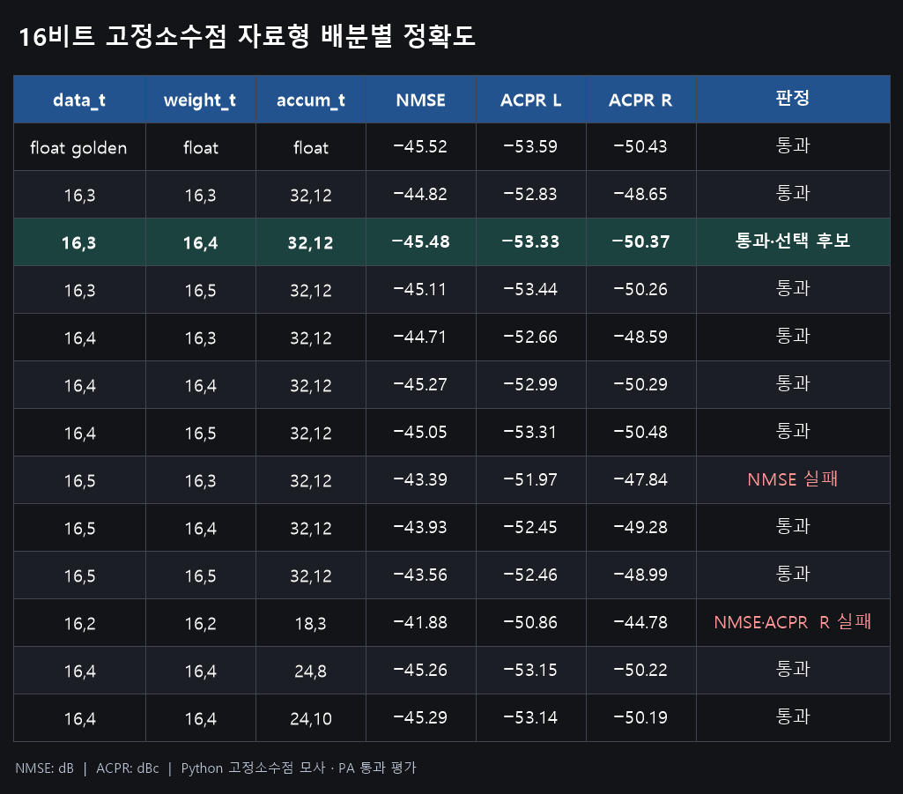

# 16비트 고정소수점 자료형 배분별 실측 결과

`W,I`는 `ap_fixed<W,I>`로, 전체 W비트 중 정수부가 I비트(부호 포함)라는 뜻입니다.
NMSE 단위는 dB, ACPR 단위는 dBc입니다.

| data_t | weight_t | accum_t | NMSE | ACPR L | ACPR R | 판정 |
|---|---|---|---:|---:|---:|---|
| float golden | float | float | −45.52 | −53.59 | −50.43 | 통과 |
| 16,3 | 16,3 | 32,12 | −44.82 | −52.83 | −48.65 | 통과 |
| **16,3** | **16,4** | **32,12** | **−45.48** | **−53.33** | **−50.37** | **통과·선택 후보** |
| 16,3 | 16,5 | 32,12 | −45.11 | −53.44 | −50.26 | 통과 |
| 16,4 | 16,3 | 32,12 | −44.71 | −52.66 | −48.59 | 통과 |
| 16,4 | 16,4 | 32,12 | −45.27 | −52.99 | −50.29 | 통과 |
| 16,4 | 16,5 | 32,12 | −45.05 | −53.31 | −50.48 | 통과 |
| 16,5 | 16,3 | 32,12 | −43.39 | −51.97 | −47.84 | NMSE 실패 |
| 16,5 | 16,4 | 32,12 | −43.93 | −52.45 | −49.28 | 통과 |
| 16,5 | 16,5 | 32,12 | −43.56 | −52.46 | −48.99 | 통과 |
| 16,2 | 16,2 | 18,3 | −41.88 | −50.86 | −44.78 | NMSE·ACPR R 실패 |
| 16,4 | 16,4 | 24,8 | −45.26 | −53.15 | −50.22 | 통과 |
| 16,4 | 16,4 | 24,10 | −45.29 | −53.14 | −50.19 | 통과 |

통과 기준: NMSE ≤ −43.48 dB, ACPR L ≤ −50.39 dBc, ACPR R ≤ −47.83 dBc.

위 표는 정확한 활성화·FEx와 2,560샘플 초기화를 가정한 Python 고정소수점 모사의 PA 통과 평가입니다.
각 후보의 C/RTL 또는 배치·배선 실측값을 뜻하지는 않습니다.
선택 후보의 C-sim 검증과 상세 조건은 [v1.1 초기 reference](v1.1_reference.md)를 참고하세요.
